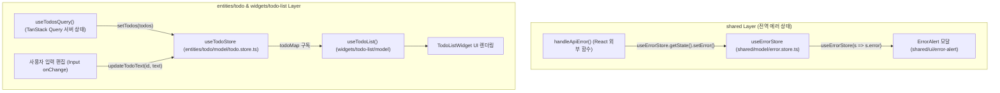

# `jotai`에서 `zustand`로의 클라이언트 상태관리 마이그레이션 가이드 (FSD 아키텍처)

본 문서는 Vite + React + TypeScript 환경에서 **FSD(Feature-Sliced Design) 아키텍처**를 유지하며, 기존 `jotai` 기반 클라이언트 상태관리를 **`zustand` 기반 상태관리**로 마이그레이션한 설계 원리와 구현 상세를 정리합니다.

---

## 1. 마이그레이션 배경 및 핵심 목표

### 💡 기존 구조(`jotai`)와 변경 구조(`zustand`)의 차이점
1. **React 컴포넌트 외부 접근을 위한 별도 Store 주입 불필요**:
   - **Jotai**: Axios 인터셉터나 공통 에러 핸들러(`handleApiError`)처럼 React 트리 바깥에서 상태를 변경하려면 `createStore()`로 `appStore`를 별도 생성하고, 최상단에 `<Provider store={appStore}>`를 반드시 감싸야만 UI와 외부 코드가 동일한 상태를 바라볼 수 있었습니다.
   - **Zustand**: 스토어 자체가 모듈 싱글톤으로 생성되므로 별도의 `<Provider>` 래퍼 없이도, React 컴포넌트 내부에서는 `useErrorStore((s) => s.error)` 훅으로 구독하고 React 외부 함수에서는 `useErrorStore.getState().setError(...)`로 즉시 상태를 읽고 쓸 수 있습니다.
2. **상태(State)와 액션(Action)의 응집도 향상**:
   - **Jotai**: 원시 Atom(`todoMapAtom`)만 정의하고 상태를 변환하는 로직(`Object.fromEntries(...)`, 불변성 갱신)이 소비처(`widgets/todo-list`)에 흩어지기 쉬웠습니다.
   - **Zustand**: 도메인 엔티티 스토어(`useTodoStore`) 내부에 상태(`todoMap`)와 상태 변경 액션(`setTodos`, `updateTodoText`)을 함께 캡슐화하여 FSD `entities` 레이어의 응집도를 높이고 `widgets` 레이어의 코드를 단순화할 수 있습니다.

---

## 2. 전체 아키텍처 및 상태 흐름



---

## 3. `jotai` vs `zustand` 핵심 패턴 1:1 매핑 비교

| 기능 구분 | 기존 (`jotai`) | 변경 (`zustand`) | 비고 |
| :--- | :--- | :--- | :--- |
| **스토어 / 상태 선언** | `export const errorAtom = atom<ErrorState \| null>(null)` | `export const useErrorStore = create<ErrorStore>((set) => ({ ... }))` | 상태와 액션 메서드를 하나의 스토어에 응집 |
| **전역 Provider 설정** | `<JotaiProvider>` (`<Provider store={appStore}>`) | **불필요** (`JotaiProvider` 및 `store.ts` 제거) | Provider Hell 방지 및 트리 단순화 |
| **React 내부 상태 구독** | `const [error, setError] = useAtom(errorAtom)` | `const error = useErrorStore((state) => state.error)` | Selector 기반으로 필요한 필드만 정밀 구독 |
| **React 내부 상태 변경** | `setTodoMap((prev) => ({ ... }))` | `const updateTodoText = useTodoStore((s) => s.updateTodoText)` | 도메인 액션 메서드 호출로 의도 명확화 |
| **React 외부 상태 변경** | `appStore.set(errorAtom, { ... })` | `useErrorStore.getState().setError({ ... })` | 별도 `createStore()` 없이 `getState()`로 즉시 접근 |

---

## 4. FSD 레이어별 상세 마이그레이션 내역

### ① `app/providers` 레이어: 불필요한 Provider 제거

Zustand는 React Context에 의존하지 않는 외부 스토어(`useSyncExternalStore` 기반)이므로 `jotai-provider.tsx`와 `shared/model/store.ts`(`appStore`)를 제거하고 [app-provider.tsx](file:///d:/project-workspace/vite-react-hooks-tanstackroute-zustand/src/app/providers/app-provider.tsx)를 단순화했습니다.

```tsx
// src/app/providers/app-provider.tsx
import type { PropsWithChildren } from 'react';
import { QueryProvider } from './query-provider';

export const AppProvider = ({ children }: PropsWithChildren) => {
  return <QueryProvider>{children}</QueryProvider>;
};
```

---

### ② `shared` 레이어: 전역 에러 스토어 (`useErrorStore`) 및 에러 핸들러 연동

기존의 `error.atom.ts`와 `store.ts`를 통합하여 [error.store.ts](file:///d:/project-workspace/vite-react-hooks-tanstackroute-zustand/src/shared/model/error.store.ts) 하나로 구성했습니다.

* **파일 경로**:
  * [error.store.ts](file:///d:/project-workspace/vite-react-hooks-tanstackroute-zustand/src/shared/model/error.store.ts)
  * [error-handler.ts](file:///d:/project-workspace/vite-react-hooks-tanstackroute-zustand/src/shared/api/error-handler.ts)
  * [error-alert.tsx](file:///d:/project-workspace/vite-react-hooks-tanstackroute-zustand/src/shared/ui/error-alert/error-alert.tsx)

#### 1) 전역 에러 스토어 정의 ([error.store.ts](file:///d:/project-workspace/vite-react-hooks-tanstackroute-zustand/src/shared/model/error.store.ts))
```ts
// src/shared/model/error.store.ts
import { create } from 'zustand';

export interface ErrorState {
  errorCode?: string;
  errorType?: string;
  message?: string;
  onConfirm?: () => void;
}

export interface ErrorStore {
  error: ErrorState | null;
  setError: (error: ErrorState | null) => void;
  clearError: () => void;
}

export const useErrorStore = create<ErrorStore>((set) => ({
  error: null,
  setError: (error) => set({ error }),
  clearError: () => set({ error: null }),
}));
```

#### 2) React 컴포넌트 외부에서 에러 상태 업데이트 ([error-handler.ts](file:///d:/project-workspace/vite-react-hooks-tanstackroute-zustand/src/shared/api/error-handler.ts#L37-L71))
```ts
// src/shared/api/error-handler.ts
import { isAxiosError } from 'axios';
import { useErrorStore } from '@/shared/model';

export function handleApiError(error: unknown) {
  const axiosError = isAxiosError<ApiErrorResponse>(error) ? error : undefined;
  const status = axiosError?.response?.status;
  const { setError } = useErrorStore.getState();

  if (status === 401) {
    setError({
      message: "인증이 만료되었거나 권한이 없습니다.\n다시 로그인해주세요.",
      onConfirm: () => {
        window.location.href = "/login";
      },
    });
    return;
  }

  // ... 에러 메시지 추출 후 전역 에러 상태 설정
  setError({ errorCode, errorType, message });
}
```

#### 3) 전역 에러 알림 모달 컴포넌트에서 구독 ([error-alert.tsx](file:///d:/project-workspace/vite-react-hooks-tanstackroute-zustand/src/shared/ui/error-alert/error-alert.tsx#L19-L40))
```tsx
// src/shared/ui/error-alert/error-alert.tsx
export const ErrorAlert = () => {
  const error = useErrorStore((state) => state.error);
  const clearError = useErrorStore((state) => state.clearError);
  // ...
  const handleConfirm = () => {
    const onConfirm = error?.onConfirm;
    clearError();
    onConfirm?.();
  };
  // ...
};
```

---

### ③ `entities/todo` & `widgets/todo-list` 레이어: Todo 로컬 상태 스토어 (`useTodoStore`)

TanStack Query(`useTodosQuery`)로 패칭한 서버 목록 데이터를 인풋에서 즉시 편집할 수 있도록 Dictionary(`TodoMap`) 형태의 로컬 클라이언트 상태로 동기화하고 관리합니다.

* **파일 경로**:
  * [todo.store.ts](file:///d:/project-workspace/vite-react-hooks-tanstackroute-zustand/src/entities/todo/model/todo.store.ts)
  * [use-todo-list.ts](file:///d:/project-workspace/vite-react-hooks-tanstackroute-zustand/src/widgets/todo-list/model/use-todo-list.ts)

#### 1) Todo 도메인 스토어 및 액션 캡슐화 ([todo.store.ts](file:///d:/project-workspace/vite-react-hooks-tanstackroute-zustand/src/entities/todo/model/todo.store.ts))
```ts
// src/entities/todo/model/todo.store.ts
import { create } from 'zustand';
import type { Todo, TodoMap } from './todo.entity';

export interface TodoStore {
  todoMap: TodoMap;
  setTodoMap: (todoMap: TodoMap) => void;
  setTodos: (todos: Todo[]) => void;
  updateTodoText: (id: string, text: string) => void;
}

export const useTodoStore = create<TodoStore>((set) => ({
  todoMap: {},
  setTodoMap: (todoMap) => set({ todoMap }),
  setTodos: (todos) =>
    set({
      todoMap: Object.fromEntries(todos.map((todo) => [todo.id, todo])),
    }),
  updateTodoText: (id, text) =>
    set((state) => {
      const target = state.todoMap[id];
      if (!target) return state;
      return {
        todoMap: {
          ...state.todoMap,
          [id]: { ...target, text },
        },
      };
    }),
}));
```

#### 2) 위젯 모델 훅에서 스토어 액션 활용 ([use-todo-list.ts](file:///d:/project-workspace/vite-react-hooks-tanstackroute-zustand/src/widgets/todo-list/model/use-todo-list.ts))
```ts
// src/widgets/todo-list/model/use-todo-list.ts
import { useEffect } from 'react';
import { useTodosQuery, useTodoStore } from '@/entities/todo';
import { useUpdateTodo, useDeleteTodo } from '@/features/todo';

export const useTodoList = () => {
  const { data: todos, isLoading } = useTodosQuery();
  const todoMap = useTodoStore((state) => state.todoMap);
  const setTodos = useTodoStore((state) => state.setTodos);
  const updateTodoText = useTodoStore((state) => state.updateTodoText);

  const updateMutation = useUpdateTodo();
  const deleteMutation = useDeleteTodo();

  // 서버에서 조회된 데이터를 로컬 Zustand 상태(dictionary)로 동기화
  useEffect(() => {
    if (todos) {
      setTodos(todos);
    }
  }, [todos, setTodos]);

  // 로컬 상태 편집 핸들러
  const handleEditChange = (id: string, text: string) => {
    updateTodoText(id, text);
  };

  // 서버 수정 요청 핸들러
  const handleUpdate = (id: string) => {
    const target = todoMap[id];
    if (target) {
      updateMutation.mutate(target);
    }
  };

  // 서버 삭제 요청 핸들러
  const handleDelete = (id: string) => {
    deleteMutation.mutate(id);
  };

  return {
    todoList: Object.values(todoMap),
    isLoading,
    handleEditChange,
    handleUpdate,
    handleDelete,
  };
};
```

---

## 5. 마이그레이션 전·후 파일 구조 비교

```text
src/
├── app/
│   └── providers/
│       ├── app-provider.tsx             # [단순화] JotaiProvider 래퍼 제거
│       ├── query-provider.tsx           # TanStack Query Provider 유지
│       └── index.ts                     # [정리] JotaiProvider export 제거
│       (❌ jotai-provider.tsx 삭제)
├── shared/
│   ├── model/
│   │   ├── error.store.ts               # [신규] useErrorStore (상태 + setError/clearError 액션)
│   │   └── index.ts                     # [변경] useErrorStore, ErrorState, ErrorStore export
│   │   (❌ error.atom.ts 삭제)
│   │   (❌ store.ts 삭제 — 별도 appStore 인스턴스 불필요)
│   ├── api/
│   │   └── error-handler.ts             # [변경] useErrorStore.getState().setError() 직접 호출
│   └── ui/
│       └── error-alert/
│           └── error-alert.tsx          # [변경] useErrorStore 셀렉터 기반 구독
├── entities/
│   └── todo/
│       └── model/
│           ├── todo.entity.ts           # 도메인 엔티티 및 DTO 타입 유지
│           ├── todo.store.ts            # [신규] useTodoStore (todoMap + setTodos/updateTodoText)
│           └── index.ts                 # [변경] todo.store export
│           (❌ todo.atom.ts 삭제)
└── widgets/
    └── todo-list/
        └── model/
            └── use-todo-list.ts         # [변경] useTodoStore 셀렉터 및 액션 연동
```

