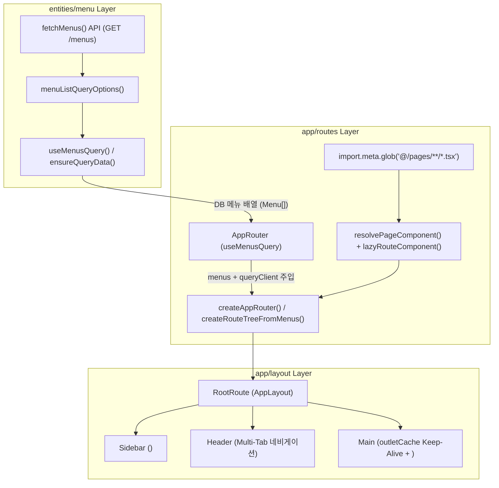

# `react-router-dom`에서 `@tanstack/react-router`로의 마이그레이션 가이드 (FSD 아키텍처 & DB API 동적 라우팅)

본 문서는 Vite + React + TypeScript 환경에서 **FSD(Feature-Sliced Design) 아키텍처**를 유지하며, 기존 `react-router-dom` 기반 라우팅 구조를 **`@tanstack/react-router` + `@tanstack/react-query` 결합형 동적 라우팅 구조**로 마이그레이션한 설계 원리와 구현 상세를 정리합니다.

---

## 1. 마이그레이션 배경 및 핵심 목표

### 💡 기존 구조(`react-router-dom`)의 한계점
1. **정적 JSON 의존성 (`default-menus.ts`)**:
   - 기존에는 라우터 초기화 시점에 `db.json` 파일을 프론트엔드 번들에 직접 정적 `import`하여 라우트 트리를 생성하고, `loader`에서 별도로 `/menus` API를 다시 호출하는 이중 구조였습니다.
2. **라우터와 서버 상태 관리(TanStack Query)의 분리**:
   - 라우터 `loader`의 데이터 패칭과 TanStack Query의 `QueryClient` 캐시가 분리되어 있어, 동일한 메뉴 데이터를 중복 조회하거나 캐시 무효화 정책을 일원화하기 어려웠습니다.
3. **타입 안전성 및 이벤트 제어**:
   - 동적 라우트 컨텍스트 주입(`QueryClient`), 프리로딩(`defaultPreload: 'intent'`), 네비게이션 완료 이벤트 구독(`router.subscribe('onResolved')`) 등 엔터프라이즈 환경에서 요구되는 세밀한 제어를 위해 TanStack Router 도입이 필요했습니다.

### 🎯 마이그레이션 핵심 목표
* **100% DB API 기반 동적 라우트 트리 구성**: 정적 `default-menus.ts`를 제거하고, 백엔드 API(`GET /menus`)에서 조회한 DB 메뉴 데이터를 단일 진실 공급원(Single Source of Truth)으로 삼아 라우트 트리를 동적 생성합니다.
* **TanStack Query + TanStack Router 캐시 통합**: `queryOptions`와 `createRootRouteWithContext<RouterContext>()`를 통해 라우터 초기화 시 패칭된 메뉴 데이터를 `QueryClient` 캐시에 저장하고, Root `loader`에서 `ensureQueryData`로 네트워크 중복 호출 없이 즉시 재사용합니다.
* **FSD 레이어 단방향 의존성 준수**: `app` $\rightarrow$ `pages` $\rightarrow$ `widgets` $\rightarrow$ `features` $\rightarrow$ `entities` $\rightarrow$ `shared`의 FSD 계층 규칙과 Vite `import.meta.glob` 기반 온디맨드 코드 스플리팅(`lazyRouteComponent`)을 그대로 유지합니다.
* **다중 탭(MDI) Keep-Alive 상태 보존**: 최대 5개 탭 제한 및 탭 전환 시 기존 컴포넌트의 DOM/State를 유지하는 `outletCache` 구조를 TanStack Router 환경에서도 동일하게 유지합니다.

---

## 2. 전체 아키텍처 및 데이터 흐름



---

## 3. `react-router-dom` vs `@tanstack/react-router` 핵심 API 1:1 매핑

| 기능 구분 | 기존 (`react-router-dom`) | 변경 (`@tanstack/react-router`) | 비고 |
| :--- | :--- | :--- | :--- |
| **라우터 인스턴스 생성** | `createBrowserRouter(routes)` | `createRouter({ routeTree, context })` | `QueryClient` 등 전역 컨텍스트 주입 지원 |
| **루트 라우트 정의** | `{ path: '/', id: 'root', element: <AppLayout /> }` | `createRootRouteWithContext<RouterContext>()({ component: AppLayout })` | 루트 레벨 타입 안전 컨텍스트 보장 |
| **자식 라우트 정의** | `{ path: 'timer', lazy: ... }` | `createRoute({ getParentRoute: () => parentRoute, path: 'timer', component })` | 부모-자식 참조로 트리 구성 (`addChildren`) |
| **지연 로딩 (Code Splitting)** | `lazy: async () => ({ Component: module.default })` | `component: lazyRouteComponent(importFn)` | `defaultPreload: 'intent'`와 결합해 호버 시 자동 프리로드 |
| **리다이렉트 처리** | `element: <Navigate to="/use-state/timer" replace />` | `beforeLoad: () => { throw redirect({ to: defaultStartPath, replace: true }); }` | 컴포넌트 마운트 전 라우터 관문 단계에서 즉시 리다이렉트 |
| **초기화 대기 / 에러 / 404** | `HydrateFallback`, `errorElement`, `path: '*'` | `pendingComponent`, `errorComponent`, `notFoundComponent` | Root Route 옵션으로 일관되게 선언 |
| **프로그래매틱 이동** | `navigate(path, { replace: true })` | `navigate({ to: path, replace: true })` | 옵션 객체 방식으로 통일 |
| **활성 링크 스타일링** | `<NavLink className={({ isActive }) => ...}>` | `<Link className="..." activeProps={{ className: "active" }}>` | 활성 상태에서 `className` 자동 병합 |
| **로더 데이터 조회** | `useLoaderData()` | `useLoaderData({ from: '__root__' })` | 어느 하위 컴포넌트에서든 출발 라우트 ID 지정 조회 가능 |
| **로딩 상태 감지** | `const nav = useNavigation(); nav.state === 'loading'` | `useRouterState({ select: (s) => s.isLoading })` | 필요한 상태만 선택 구독하여 불필요한 리렌더링 방지 |

---

## 4. FSD 레이어별 상세 마이그레이션 내역

### ① `entities/menu` 레이어: 도메인 모델 및 Query Options 정의

라우터의 `loader`와 리액트 컴포넌트(`AppRouter`) 양쪽에서 동일한 쿼리 키(`['menus', 'list']`)와 캐시를 공유할 수 있도록 TanStack Query의 `queryOptions` 패턴을 적용했습니다.

* **파일 경로**:
  * [menu.entity.ts](file:///d:/project-workspace/vite-react-hooks-tanstackroute-zustand/src/entities/menu/model/menu.entity.ts)
  * [use-menus.query.ts](file:///d:/project-workspace/vite-react-hooks-tanstackroute-zustand/src/entities/menu/api/use-menus.query.ts)

```ts
// src/entities/menu/api/use-menus.query.ts
import { queryOptions, useQuery } from '@tanstack/react-query';
import type { Menu } from '../model/menu.entity';
import { fetchMenus } from './menu.api';

export const menuQueryKeys = {
  all: ['menus'] as const,
  list: () => [...menuQueryKeys.all, 'list'] as const,
};

/**
 * TanStack Router loader(ensureQueryData)와 컴포넌트(useQuery) 양쪽에서
 * 동일하게 재사용할 수 있는 메뉴 목록 Query Options 팩토리
 */
export const menuListQueryOptions = () =>
  queryOptions<Menu[]>({
    queryKey: menuQueryKeys.list(),
    queryFn: fetchMenus,
    staleTime: Infinity,
    retry: 1,
    meta: { skipGlobalError: true },
  });

export const useMenusQuery = () => {
  return useQuery(menuListQueryOptions());
};
```

또한 DB에서 읽어온 메뉴 트리에서 최초 진입 시 이동할 첫 번째 최하위(Leaf) 메뉴 경로를 동적으로 탐색하는 [`findFirstLeafPath`](file:///d:/project-workspace/vite-react-hooks-tanstackroute-zustand/src/entities/menu/model/menu.entity.ts#L49-L61) 순수 함수를 `menu.entity.ts`에 추가했습니다.

---

### ② `app/routes` 레이어: DB API 기반 동적 라우트 트리 팩토리

기존의 정적 `default-menus.ts`를 삭제하고, API로부터 받아온 `Menu[]` 배열과 Vite의 `import.meta.glob`을 결합하여 TanStack Router 트리를 생성합니다. 또한 Vite Fast Refresh 규칙(`react-refresh/only-export-components`)과 FSD 세그먼트 분리를 위해 UI Fallback 컴포넌트와 라우터 생성 로직을 분리했습니다.

* **파일 경로**:
  * [routes.ts](file:///d:/project-workspace/vite-react-hooks-tanstackroute-zustand/src/app/routes/routes.ts) (라우터 트리 및 인스턴스 생성 팩토리)
  * [route-fallbacks.tsx](file:///d:/project-workspace/vite-react-hooks-tanstackroute-zustand/src/app/routes/ui/route-fallbacks.tsx) (`HydrateFallback`, `RootErrorBoundary`, `NotFoundComponent`, `PreparingPageFallback`)
  * [app-router.tsx](file:///d:/project-workspace/vite-react-hooks-tanstackroute-zustand/src/app/routes/app-router.tsx) (`AppRouter` 공급자 컴포넌트)

#### 핵심 포인트 1: `lazyRouteComponent`와 컴포넌트 참조 캐싱 (`resolvePageComponent`)
```ts
// src/app/routes/routes.ts
const PAGE_MODULES = import.meta.glob<{ default: RouteComponent }>(
  '@/pages/**/*.tsx',
);

const PAGE_COMPONENT_CACHE = new Map<string, RouteComponent>();

export function resolvePageComponent(
  path: string,
  menuName?: string,
): RouteComponent {
  const cached = PAGE_COMPONENT_CACHE.get(path);
  if (cached) return cached;

  const importFn =
    PAGE_MODULES[`/src/pages${path}.tsx`] ||
    PAGE_MODULES[`@/pages${path}.tsx`];

  const resolvedComponent: RouteComponent = importFn
    ? lazyRouteComponent(importFn)
    : () => createElement(PreparingPageFallback, { menuName: menuName ?? path });

  PAGE_COMPONENT_CACHE.set(path, resolvedComponent);
  return resolvedComponent;
}
```
- `PAGE_COMPONENT_CACHE`를 통해 동일한 `path`에 대해 항상 동일한 컴포넌트 참조(Reference Identity)를 반환하므로, 다중 탭 Keep-Alive 환경에서 리렌더링이 발생해도 기존 탭 컴포넌트가 언마운트되지 않습니다.

#### 핵심 포인트 2: `AppRouter`에서 DB 메뉴 조회 후 동적 라우터 생성
```tsx
// src/app/routes/app-router.tsx
const AppRouter = () => {
  const queryClient = useQueryClient();
  const { data: menus, isPending, isError } = useMenusQuery();

  const router = useMemo(() => {
    if (isPending) return null;
    return createAppRouter({
      menus: menus ?? [],
      queryClient,
      isError,
    });
  }, [menus, isPending, isError, queryClient]);

  if (isPending || !router) {
    return <HydrateFallback />;
  }

  return <RouterProvider router={router} />;
};
```
1. 앱 최초 진입 시 `useMenusQuery()`가 백엔드 API(`GET /menus`)를 호출해 DB(`db.json`)의 메뉴 목록을 가져옵니다.
2. 응답 완료 후 `createAppRouter`가 호출되어 전체 1-depth / 2-depth 라우트 트리를 동적으로 조립합니다.
3. 이후 Root Route의 `loader`가 실행될 때는 `context.queryClient.ensureQueryData(menuListQueryOptions())`가 이미 캐싱된 데이터를 즉시 반환하므로 **중복 API 호출이 발생하지 않습니다**.
4. 만약 Mock 서버(`localhost:4000`)가 꺼져 있어 API 호출이 실패하더라도 `isError: true` 상태로 폴백 라우터가 생성되어, 사이드바와 메인 화면에 에러 안내 UI가 안전하게 표시됩니다.

---

### ③ `app/layout` 레이어: 다중 탭 Keep-Alive 및 사이드바 네비게이션

* **파일 경로**:
  * [app-layout.container.tsx](file:///d:/project-workspace/vite-react-hooks-tanstackroute-zustand/src/app/layout/ui/app-layout.container.tsx)
  * [app-sidebar.tsx](file:///d:/project-workspace/vite-react-hooks-tanstackroute-zustand/src/app/layout/ui/app-sidebar.tsx)
  * [app-main.tsx](file:///d:/project-workspace/vite-react-hooks-tanstackroute-zustand/src/app/layout/ui/app-main.tsx)

#### 1) `router.subscribe('onResolved')` 기반 탭 동기화 ([app-layout.container.tsx](file:///d:/project-workspace/vite-react-hooks-tanstackroute-zustand/src/app/layout/ui/app-layout.container.tsx#L97-L143))
React 19 및 최신 `eslint-plugin-react-hooks` 환경에서는 `useEffect` 본문 내부에서 동기적으로 `setState`를 호출하면 연쇄 렌더링(Cascading Renders) 경고가 발생합니다.
TanStack Router의 외부 시스템 이벤트 구독 API인 `router.subscribe('onResolved', ...)`를 사용하여 라우트 전환이 확정된 시점에 탭 추가, `MAX_TABS`(5개) 초과 시 직전 경로 롤백, `outletCache` 등록을 깔끔하게 처리했습니다.

```tsx
// src/app/layout/ui/app-layout.container.tsx
useEffect(() => {
  return router.subscribe('onResolved', ({ toLocation }) => {
    const targetPath = toLocation.pathname;
    const title = menuTitles[targetPath];
    if (!title) return;

    setTabs((prev) => {
      if (prev.some((tab) => tab.path === targetPath)) {
        prevActivePathRef.current = targetPath;
        return prev;
      }

      if (prev.length >= MAX_TABS) {
        alert(`탭은 최대 ${MAX_TABS}개까지만 열 수 있습니다.\n기존 탭을 먼저 닫은 후 다시 시도해 주세요.`);
        navigate({ to: prevActivePathRef.current, replace: true });
        return prev;
      }

      prevActivePathRef.current = targetPath;
      setOutletCache((cachePrev) => {
        if (cachePrev[targetPath]) return cachePrev;
        return {
          ...cachePrev,
          [targetPath]: createTabElement(targetPath, title),
        };
      });
      return [...prev, { path: targetPath, title }];
    });
  });
}, [router, menuTitles, navigate]);
```

#### 2) 사이드바 `<Link>` 컴포넌트 및 프리로딩 연동 ([app-sidebar.tsx](file:///d:/project-workspace/vite-react-hooks-tanstackroute-zustand/src/app/layout/ui/app-sidebar.tsx#L88-L95))
`react-router-dom`의 `<NavLink>`를 TanStack Router의 `<Link>`로 교체했습니다.
- `activeProps={{ className: "active" }}` 속성을 통해 현재 URL과 일치하는 메뉴에 `"sidebar-nav-link active"` 클래스가 자동으로 부여됩니다.
- 라우터의 `defaultPreload: 'intent'` 설정과 결합되어, 사용자가 사이드바 메뉴 위에 마우스를 올리는 순간(`hover`/`focus`) 해당 화면의 `.js` 청크 파일을 백그라운드에서 미리 다운로드합니다.

```tsx
// src/app/layout/ui/app-sidebar.tsx
<Link
  to={subItem.path}
  className="sidebar-nav-link"
  activeProps={{ className: "active" }}
>
  {subItem.name}
</Link>
```

#### 3) Keep-Alive 탭 패널과 `<Outlet />` 하이브리드 렌더링 ([app-main.tsx](file:///d:/project-workspace/vite-react-hooks-tanstackroute-zustand/src/app/layout/ui/app-main.tsx#L53-L69))
- 열려 있는 메뉴 탭들은 `outletCache[tab.path]`를 통해 DOM에 유지되며, 활성 탭만 `display: block`, 비활성 탭은 `display: none`으로 처리되어 컴포넌트 내부 상태(`useState`, 타이머, 입력 폼 등)가 완벽히 보존됩니다.
- 동시에 메뉴에 등록되지 않은 예외 URL(404 Not Found 등)로 진입한 경우에는 `!isActiveTabMatched` 조건을 통해 TanStack Router의 `<Outlet />`이 렌더링되어 `NotFoundComponent`가 정상 출력됩니다.

---

## 5. 마이그레이션 전·후 파일 구조 비교

```text
src/
├── entities/
│   └── menu/
│       ├── api/
│       │   ├── menu.api.ts              # GET /menus API 호출
│       │   ├── use-menus.query.ts       # [신규] menuListQueryOptions & useMenusQuery
│       │   └── index.ts                 # [신규] api 세그먼트 배럴 익스포트
│       ├── model/
│       │   ├── menu.entity.ts           # [확장] findFirstLeafPath 순수 함수 추가
│       │   └── index.ts                 # [신규] model 세그먼트 배럴 익스포트
│       └── index.ts                     # entities/menu Public API
└── app/
    ├── routes/
    │   ├── ui/
    │   │   └── route-fallbacks.tsx      # [신규] Hydrate/Error/404/준비중 Fallback UI 분리
    │   ├── routes.ts                    # [전환] TanStack Router 동적 트리 & lazyRouteComponent 팩토리
    │   ├── app-router.tsx               # [전환] DB 메뉴 쿼리 연동 동적 RouterProvider
    │   ├── routes.module.css            # 라우트 상태 화면 스타일
    │   └── index.ts                     # [신규] app/routes 배럴 익스포트
    │   (❌ default-menus.ts 삭제 — 정적 db.json 직접 참조 완전 제거)
    └── layout/
        └── ui/
            ├── app-layout.container.tsx # [전환] TanStack Router Hooks & onResolved 구독 적용
            ├── app-sidebar.tsx          # [전환] TanStack Router <Link activeProps> 적용
            ├── app-main.tsx             # [전환] Keep-Alive 탭 캐시 + <Outlet /> 결합
            └── app-header.tsx           # 상단 멀티 탭 UI (변경 없음)
```

