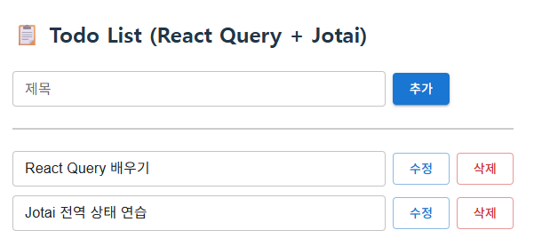

# React + TanStack Query + Jotai

# 프로젝트 생성

## **pnpm create vite**

## * 프로젝트 명 : vite-react-query-jotai-crud-example**

# 패키지 설치

## **pnpm add uuid @tanstack/react-query axios jotai**

# json-server 실행용 db.json 파일 생성

```json
{  
    "todos": [    
         { "id": "1", "title": "React Query 배우기" },    
         { "id": "2", "title": "Jotai 전역 상태 연습" }  
     ]
}
```

# json-server 실행

## **1. 패키지 설치 : pnpm add -D json-server**

## **2. 실행 : pnpm json-server –watch db.json –port 3000**

# 🧩 Jotai vs Zustand 개발 관점에서 비교

## ✅ Jotai — “React스럽고 선언적”

1. todoAtoms.js

```jsx
// todoAtoms.js
import { atom } from "jotai";
export const todosAtom = atom([]);
```

2. TodoList.jsx

```jsx
// TodoList.jsx
const [todos, setTodos] = useAtom(todosAtom);
```

- **React의 useState처럼 직관적상태를 여러 작은 단위(atom)로 쪼개 조합 가능각 atom은 독립적 → 불필요한 리렌더 최소화비즈니스 로직은 컴포넌트 혹은 별도 함수로 분리 (명령형 store 없음)hook만으로 구성 가능 → 코드 가볍고 트리 shake-friendly💡 “컴포넌트 단위 로컬 상태 관리”엔 정말 이상적입니다.**

# ✅ Zustand — “store 중심적이고 명령적”

1. useTodoStore.js

```jsx
// useTodoStore.js
import { create } from "zustand";
export const useTodoStore = create((set) => ({
  todos: [],  
  addTodo: (todo) => set((state) => ({ 
              todos: [...state.todos, todo] 
           })),  
  deleteTodo: (id) => set((state) => ({ 
              todos: state.todos.filter(t => t.id !== id) 
           })),
}));
```

2. TodoList.jsx

```jsx
const { todos, addTodo, deleteTodo } = useTodoStore();
```

**store 객체 안에 상태 + 메서드가 명확하게 들어 있음**

**여러 상태가 하나의 store에 묶이므로 “도메인 단위 관리”에 유리Re-render control이 용이** 

**(shallow selector 등) store가 독립적 객체이므로 React 외부에서도 접근 가능 (예: event listener, socket 등)**

**💡 “전역 비즈니스 로직 + 도메인 단위 store”를 구성할 때 더 명확합니다.**

# ⚙️ 성능 관점

| 측면 | **Jotai** | **Zustand** |
| --- | --- | --- |
| 리렌더링 | atom 단위로 자동 분리 → 미세 단위 렌더 최소화 | selector를 잘못 쓰면 과렌더 가능 |
| 메모리 | 매우 가볍고 tree-shake 가능 | store별로 약간의 오버헤드 |
| SSR/React 18 | 100% React state 기반 → 호환성 좋음 | SSR 시 store 초기화 신경 필요 |
| 병렬 상태 조합 | atom 간의 의존성 자동 추적 | 수동 set/get으로 의존 처리 |

## Jotai는 “리렌더링 최소화 + 선언적 구조”에서 더 유리,

## 반면 Zustand는 “명령형 로직 제어 + 전역 접근성”에서 강점을 가집니다.

# 🧠 개발 효율성 비교 (로컬 상태 관리 기준)

| 항목 | **Jotai** | **Zustand** |
| --- | --- | --- |
| boilerplate | 거의 없음 (`useAtom`만) | store 생성/메서드 정의 필요 |
| TypeScript | 타입 추론 자연스럽고 간단 | 메서드/상태 수동 타입 선언 필요 |
| React-query와 연동 | 매우 자연스러움 (query data → atom) | useEffect로 sync 로직 수동 작성 |
| 테스트 | React hook 그대로 테스트 가능 | store mocking 필요 |
| 직관성 | React 개발자에게 익숙한 패턴 | Redux 경험자에게 익숙한 패턴 |

## ✅ 즉, “컴포넌트 중심 / 작은 단위 / React스러운 로컬 상태 관리” → Jotai가 더 효율적

## 🧩 “비즈니스 로직+전역 공유 store+비 React 환경 접근” → Zustand가 적합

# 💬 실제 적용 예

## Jotai 적합

### Todo, Form, Filter, Modal 상태

### React Query, Suspense, Server state와 조합

### 대규모 프로젝트의 “UI 단 상태” 분리

## Zustand 적합

### 전역 App-level store (ex. Auth, Theme)

### 비즈니스 로직 중심 서비스 (ex. Cart, Chat, Game)

### React 외부(소켓, 이벤트 핸들러)에서도 접근해야 하는 데이터

# ✅ 결론 요약

| 구분 | Jotai | Zustand |
| --- | --- | --- |
| 상태 구조 | atom 단위 (작고 유연) | store 단위 (묶음 중심) |
| 코드 복잡도 | 단순, 선언적 | 약간 더 명령적 |
| 렌더링 효율 | 매우 높음 (자동 의존 추적) | 높음 (selector 필요) |
| 로컬 상태 관리 | ⭐ 매우 효율적 | 가능하지만 오버헤드 있음 |
| 전역 비즈니스 로직 | 가능하지만 분산됨 | ⭐ 적합 (집중 관리) |

---

# 💡 정리하자면 —

## UI 단위의 로컬 상태, React Query와 연동 → Jotai가 더 효율적

## 비즈니스 로직 중심의 전역 store, socket/외부 이벤트 연동 → Zustand가 더 자연스러움

# store\todoAtoms.js

```jsx
import { atom } from "jotai";

/**
 * todosByIdAtom
 * 형태: { "uuid-1": { id: "uuid-1", title: "..." }, "uuid-2": {...}, ... }
 */
export const todosByIdAtom = atom({});
```

# components\TodoList.jsx (MUI 적용 버전)

```jsx
import { useQuery, useMutation, useQueryClient } from "@tanstack/react-query";
import { useAtom } from "jotai";
import { useEffect, useState } from "react";
import axios from "axios";
import { v4 as uuidv4 } from "uuid";
import { todosByIdAtom } from "../store/todoAtoms";
import { Button, TextField, Divider } from "@mui/material";

const TodoList = () => {
  //
  const queryClient = useQueryClient();
  const [todosById, setTodosById] = useAtom(todosByIdAtom);
  const [title, setTitle] = useState("");

  // 📦 조회(Read)
  const { data: todos, isLoading } = useQuery({
    queryKey: ["todolist"],
    queryFn: async () => {
      const res = await axios.get("http://localhost:3000/todos");
      return res.data;
    },
  });

  /** React Query 데이터 → jotai atom 동기화
   * useEffect 의존성 배열에 'todosById' 객체를 추가하면
   * handleEditChange가 로컬 atom(todosById)을 업데이트 
   * → todosById가 변경 → useEffect 재실행 → 
   * 다시 서버에서 받은 todos로 덮어쓰기 (setTodosById(mapped))
   * 그래서 input tag에서 타이핑한 값이 즉시 원복되어 “수정이 안 되는 것처럼” 보입니다
   * 즉, “서버→로컬 동기화” 이펙트가 “로컬 편집”까지 계속 덮어써 버리는 케이스
   * useEffect 의존성 배열에 'todosById' 제거, setter 만 추가
   */ 
  useEffect(() => {
    // 서버에서 읽어온 배열이 존재하고 현재 로컬 배열의 길이와 서버에서 읽어온 배열의 길이가 다르면
    if (todos)  {
      // 서버에서 읽어온 배열로 로컬 딕셔너리(자바의 map)를 생성
      // Object.fromEntries() 방식은 중복 키의 경우 자동으로 마지막 값을 유지
      const mapped = Object.fromEntries(todos.map((t) => [t.id, t]));
      setTodosById(mapped);
    }
  }, [todos, setTodosById]);

  // 🟢 등록(Create)
  const addMutation = useMutation({
    mutationFn: async (newTodo) =>
      axios.post("http://localhost:3000/todos", newTodo),
    onSuccess: () => {
      alert("등록 완료!");
      setTitle("");
      queryClient.invalidateQueries(["todolist"]);
    },
    onError: () => alert("등록 실패!"),    
  });

  const handleAdd = () => {
    if (!title.trim()) return alert("할일을 입력하세요!");
    const newTodo = { id: uuidv4(), title };
    addMutation.mutate(newTodo);
    setTitle(""); // 입력창 초기화
  };

  // 🟡 수정(Update)
  const updateMutation = useMutation({
    mutationFn: async (updatedTodo) =>
      axios.put(`http://localhost:3000/todos/${updatedTodo.id}`, updatedTodo),
    onSuccess: () => {
      alert("수정 완료!");
      setTitle("");
      queryClient.invalidateQueries(["todolist"]);
    },
    onError: () => alert("수정 실패!"),    
  });

  const handleUpdate = (id, newTitle) => {
    const findTodo = todosById[id];
    const updatedTodo = {...findTodo, title: newTitle};
    updateMutation.mutate(updatedTodo);
  };

  const handleEditChange = (id, newTitle) => {
    setTodosById((prev) => ({
      ...prev,
      [id]: { ...prev[id], title: newTitle },
    }));
  };

  // 🔴 삭제(Delete)
  const deleteMutation = useMutation({
    mutationFn: async (id) =>
      axios.delete(`http://localhost:3000/todos/${id}`),
    onSuccess: () => queryClient.invalidateQueries(["todolist"]),
  });

  const handleDelete = (id) => {
    deleteMutation.mutate(id);
  };

  if (isLoading) return <p>로딩 중...</p>;

  // key, value 쌍으로 이루어진 객체 → 배열 변환
  const todoList = Object.values(todosById);

  return (
    <div style={{ padding: "16px" }}>
      {/* 제목 */}
      <h2 style={{ marginBottom: "24px" }}>📋 Todo List (React Query + Jotai)</h2>
      {/* 입력 + 추가 버튼 영역 */}
      <div style={{
            display: "flex",
            alignItems: "center",
            justifyContent: "flex-start", // ✅ 좌측 정렬
            gap: "8px",
            marginBottom: "24px",         // ✅ ul 과의 간격
          }}>
        <TextField 
          value={title}
          onChange={(e) => setTitle(e.target.value)}  // ✅ 한글 입력 버그 해결: controlled input
          size="small"                                 // compact height
          label="제목"                                  // 상단 라벨 (옵션)
          variant="outlined"                           // 외곽선 스타일 (기본값)
          sx={{ minWidth: 420 }} // ✅ 최소 420px, 필요 시 더 늘어남
        />
        <Button variant="contained" onClick={handleAdd}>추가</Button>
      </div>
    {/* ✅ 가로 구분선 (horizontal line) */}
    <Divider
      sx={{
        borderColor: "#ccc",     // 선 색상
        borderBottomWidth: 2,    // 두께
        marginBottom: "24px",    // 아래 여백
      }}
    />
    {/* 목록 영역 */}
      <ul style={{
          display: "flex",
          flexDirection: "column", // li element 들을 세로로 배치
          gap: "10px",             // li 간 간격
          padding: 0,
          margin: 0,
          listStyle: "none",
        }}>
        {todoList?.map((todo) => (
          <li key={todo.id} style={{ display: "flex", alignItems: "center", gap: "8px" }}>
            <TextField
              value={todo.title}
              onChange={(e) => handleEditChange(todo.id, e.target.value)} // ✅ 한글 입력 버그 해결: controlled input
              size="small"                  // compact height
              // label="제목"                   // 상단 라벨 (옵션)
              variant="outlined"            // 외곽선 스타일 (기본값)
              width="420"
              sx={{ flex: 1, minWidth: 420 }} // ✅ 최소 420px, 필요 시 더 늘어남
            />
            <Button variant="outlined" color="primary" onClick={() => handleUpdate(todo.id, todo.title)} >수정</Button>
            <Button variant="outlined" color="error" onClick={() => handleDelete(todo.id)} >삭제</Button>
          </li>
        ))}
      </ul>
    </div>
  );
};

export default TodoList;
```

# App.jsx

```jsx
import { QueryClient, QueryClientProvider } from "@tanstack/react-query";
import TodoList from "./components/TodoList";

const queryClient = new QueryClient();

function App() {
  return (
    <div>
      <QueryClientProvider client={queryClient}>
        <TodoList />
      </QueryClientProvider>
    </div>
  );
};

export default App;
```

## 최종 MUI 적용 화면 이미지

